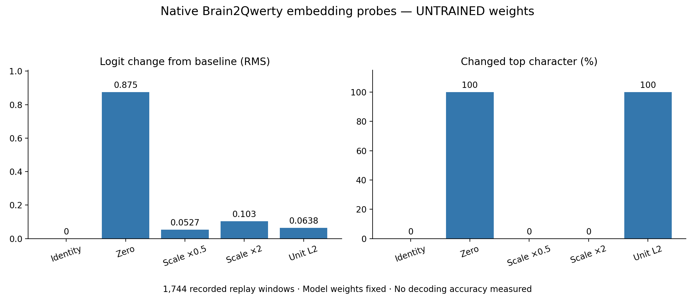

# Checkpoint recovery and work completed without retraining

Prepared October 1, 2026. The historical GPU checkpoint remains unavailable. No new GPU rental, paid infrastructure, retraining or optimizer update was started. A RunPod support request has been prepared but not sent.

## Historical recovery evidence

The user identified `/workspace/results/eeg32/best.ckpt`, recorded size **7,482,838,260 bytes**, on H100 pod **`0tbm05ey3w1xpc`**, named **`b2q-eeg32-h100-fast`**, in **US-NE-1**, last observed **August 30, 2026**. The user reports that the pod now returns 404, the account has zero pods/network volumes, and no local copy remains. Storage was pod-local persistent storage, not a detachable network volume.

These are user-provided findings, preserved in [HISTORY.json](HISTORY.json), not a fresh authenticated RunPod query. The original Windows recovery reports are not mounted here. This cloud workspace has no RunPod API-key binding or original volume mount, and fetching the linked guidance failed with proxy CONNECT 403. No access controls were bypassed.

The reported size is consistent with the 623,548,457-parameter native V1 plus AdamW state: float32 model parameters alone are about 2.49 GB. That supports the expected artifact type but does not establish its contents, recover its tensors or supply a checksum. The lost checkpoint's SHA256 is unknown.

Given the reported deleted storage and absence of another copy, support investigation is the remaining non-retraining route identified by the user. Backend retention/backups may or may not exist; recovery is not guaranteed. [SUPPORT_REQUEST.md](SUPPORT_REQUEST.md) is a concrete draft with pod identifiers, exact path/size and requested recovery priorities. It asks for cost confirmation before any paid service and does not request training restart.

## Native embedding workflow completed

Implemented `tools/native_embedding_probe.py`, which uses the actual original `BrainModule` encoder and `_transformer_forward` with the full unchanged native configuration. It performs **inference interventions** on the encoder's `[N,2048]` embeddings while fixing all native encoder, transformer and head weights. It does not migrate widths, initialize a replacement architecture, train an adapter, recover missing weights or reuse the toy proxy.

Ran it on **all 1,744 surviving recorded EEG replay windows across 48 sentences**, converting the archived 100 Hz microvolt windows to 50 Hz volts as explicitly documented in the handoff audit. Native input was `[1744,32,25]`, with the exact ordered EEG32 montage. The encoder used chunks of 64 in eval mode to bound memory; the transformer still received sentence groups with native masks. Predictions are restored to original row order.

| Intervention | Mean embedding L2 | Logit-change RMS | Changed top character |
|---|---:|---:|---:|
| Identity | 2.5408 | 0 | 0% |
| Zero embedding | 0 | 0.87534 | 100% |
| Scale ×0.5 | 1.2704 | 0.052657 | 0% |
| Scale ×2 | 5.0816 | 0.103084 | 0% |
| Normalize to unit L2 | 1.0000 | 0.063846 | 100% |

All outputs were finite `[1744,29]` logits. Before/after hashes of every model parameter matched exactly. No optimizer was created. Total runtime was **110.17 seconds**, encoder time **66.18 seconds**, peak RSS **4,232.7 MiB (4.13 GiB)**, on the existing CPU environment.



**These numbers use explicitly untrained native weights.** They show how this graph's outputs move under embedding interventions; they do not measure the lost GPU model's behavior or an EEG accuracy improvement. Recorded replay inputs do not recover the trained robust scaler or subject-index mapping. No labels were used, so no accuracy/CE claim is made. Existing saved linear-classifier metrics remain a separate historical result.

Machine-readable evidence is [native_embedding_replay_all.json](../native_embedding_replay_all.json). The standalone chart is supplied as PNG and PDF. The surviving handoff's raw EEG arrays, replay text and trained weights are excluded from the source/recovery ZIPs; the source ZIP retains the repository's existing public documentation and demo assets.

## Validation and checkpoint-ready commands

All **12 native CPU/probe tests passed**: the nine existing checkpoint/input/order tests plus probe identity/zero/frozen-weight checks, chunked-versus-whole native encoder parity in eval mode, and rejection of using the incomplete replay bridge in trained mode. The supplied sprint's 17 tests and original project's 18 tests passed in preceding validation. Ruff formatting/checks passed for the new probe and tests.

To repeat the surviving-data mechanics run in the original pinned native environment:

```bash
python b2q_v1_harness/tools/native_embedding_probe.py --untrained \
  --handoff /workspace/recovered/portable_neural_ai_handoff \
  --output b2q_v1_harness/results/native-embedding-replay.json
```

If support recovers the checkpoint, first run a CPU checkpoint/shape pass:

```bash
python b2q_v1_harness/tools/native_cpu_pass.py \
  --checkpoint /path/to/recovered/best.ckpt --trusted-checkpoint
```

With a matching **native-preprocessed** EEG32 NPZ and trained subject mapping, use the same frozen-weight probe:

```bash
python b2q_v1_harness/tools/native_embedding_probe.py \
  --checkpoint /path/to/recovered/best.ckpt --trusted-checkpoint \
  --fixture /path/to/native-preprocessed-eeg32.npz --split test \
  --output b2q_v1_harness/results/recovered-trained-embedding-probes.json
```

The surviving replay bridge deliberately rejects checkpoint mode. A supplied native fixture may provide integer labels to report batch CE/mismatch; the inspector must preserve montage, training preprocessing, original subject indexing and sentence identities. Those are batch diagnostics, not a full held-out scientific result. Missing files/incompatible states remain BLOCKED, with no random-weight fallback in checkpoint mode.

The first pending external action is account-owner submission of the prepared recovery request. No further filesystem/CPU experiment can reconstruct this lost 7.48 GB checkpoint from its filename, byte count, pod identifier or the earlier compact classifier's saved probabilities.
