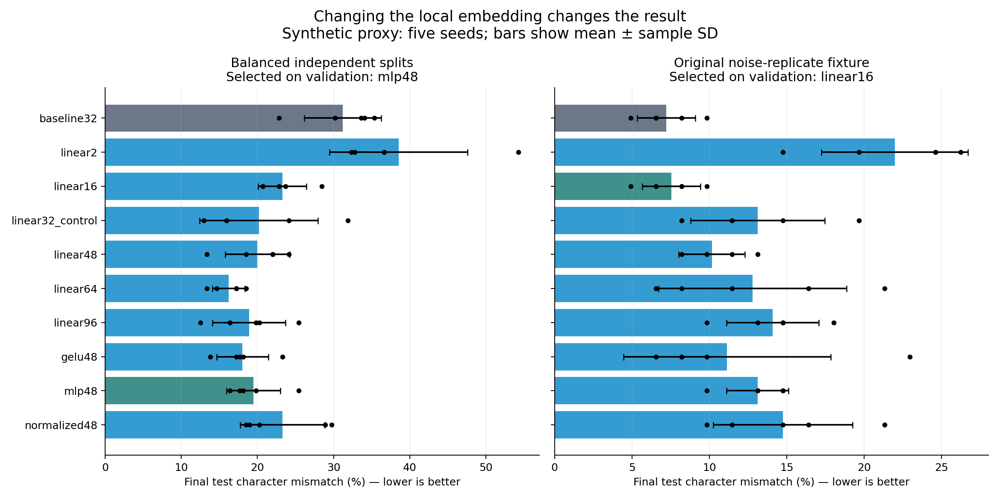
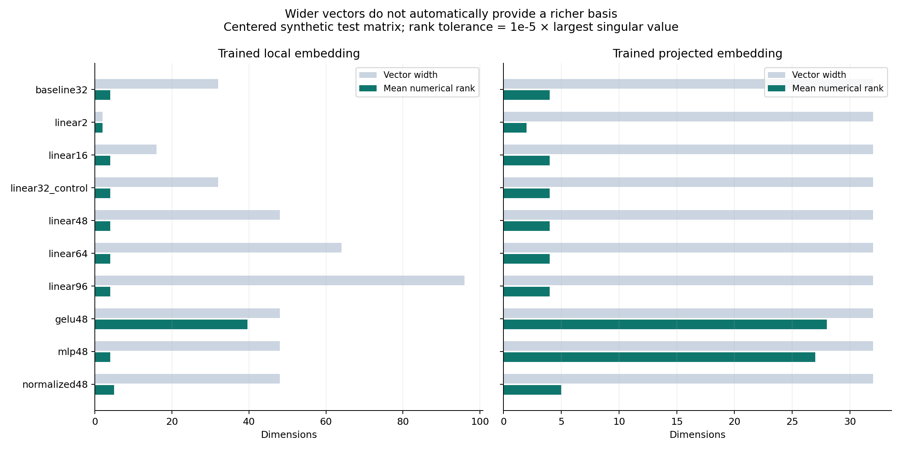
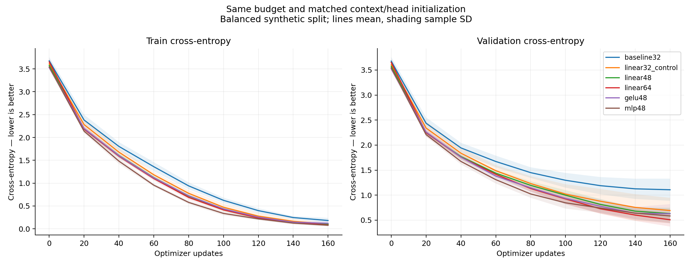

# Embedding changes and measured results

Ran 10 local-embedding variants, five initialization seeds and two synthetic protocols: **100 completed training runs, 16,000 optimizer updates**. All 10 variants passed all 16 external contracts in both protocols. All 16 controller/tool/study/analysis unit tests passed.

## Main result

On the balanced independent split, baseline mean test character mismatch was **31.21%**. A 48-wide linear embedding with projection reached **20.00%**; a 48-wide nonlinear projection selected using validation reached **19.48%**. The 64-wide linear variant had the lowest observed test mismatch, **16.21%**, but it was not selected by validation. These variants each beat baseline in all five seeds.

The 32-to-32 linear-adapter control already reached **20.17%**. Most of the 48-wide linear improvement therefore accompanies adding the projection; widening 32 to 48 adds only **0.17 percentage points** to this particular mean comparison. Widening does not establish a general capacity advantage.



## Matched comparison: balanced protocol

Character mismatch is per-keystroke classification error, not paper CER. SD is the sample standard deviation across five initialization seeds, not a confidence interval. Negative paired delta means lower error than the same-seed baseline.

| Variant | Local width | Parameters | Validation mean % | Test mean ± SD % | Paired delta pp | Seeds better / 5 |
|---|---:|---:|---:|---:|---:|---:|
| baseline32 | 32 | 9,661 | 37.59 | 31.21 ± 5.05 | +0.00 | 0 |
| linear2 | 2 | 9,607 | 41.21 | 38.53 ± 9.05 | +7.33 | 1 |
| linear16 | 16 | 10,125 | 25.00 | 23.28 ± 3.18 | -7.93 | 5 |
| linear32_control | 32 | 10,717 | 24.14 | 20.17 ± 7.77 | -11.03 | 5 |
| linear48 | 48 | 11,309 | 23.97 | 20.00 ± 4.22 | -11.21 | 5 |
| linear64 | 64 | 11,901 | 18.62 | 16.21 ± 2.12 | -15.00 | 5 |
| linear96 | 96 | 13,085 | 19.31 | 18.88 ± 4.81 | -12.33 | 5 |
| gelu48 | 48 | 11,309 | 20.69 | 18.02 ± 3.40 | -13.19 | 5 |
| mlp48 | 48 | 14,957 | 17.24 | 19.48 ± 3.55 | -11.72 | 5 |
| normalized48 | 48 | 11,405 | 24.48 | 23.28 ± 5.55 | -7.93 | 5 |

## How the embedding itself changed

The observed local vector width and centered numerical rank are different. Pure linear widening produced wider vectors with the same four-dimensional affine basis. GELU before pooling and a nonlinear projection generated a richer sampled basis; this does not imply new information or improved real EEG performance.

| Variant | Local numerical ranks across seeds | Projected numerical ranks across seeds |
|---|---|---|
| baseline32 | 4, 4, 4, 4, 4 | 4, 4, 4, 4, 4 |
| linear2 | 2, 2, 2, 2, 2 | 2, 2, 2, 2, 2 |
| linear16 | 4, 4, 4, 4, 4 | 4, 4, 4, 4, 4 |
| linear32_control | 4, 4, 4, 4, 4 | 4, 4, 4, 4, 4 |
| linear48 | 4, 4, 4, 4, 4 | 4, 4, 4, 4, 4 |
| linear64 | 4, 4, 4, 4, 4 | 4, 4, 4, 4, 4 |
| linear96 | 4, 4, 4, 4, 4 | 4, 4, 4, 4, 4 |
| gelu48 | 40, 40, 38, 41, 39 | 28, 28, 27, 29, 28 |
| mlp48 | 4, 4, 4, 4, 4 | 27, 28, 27, 26, 27 |
| normalized48 | 5, 5, 5, 5, 5 | 5, 5, 5, 5, 5 |

Numerical ranks use centered synthetic test embedding matrices and relative singular-value tolerance 1e-5. They measure this finite sample matrix, not intrinsic data dimension or information content. For the linear models, pooling four statistics followed by two linear maps remains an affine map of four pooled statistics. Width ≥4 can reparameterize that map without changing its function class. The different finite-budget results can reflect optimization, initialization and regularization.



## How the result moves through training

Saved train/validation cross-entropy and character mismatch at updates 0,20,...,160 for every seed/variant. The following plot shows mean curves with sample-SD shading. Full histories are in balanced_comparison.json and legacy_comparison.json.



## The original fixture gives a different ranking

The original 61-character fixture reuses the same labels, coordinates and identities with new noise. It is a noise-replicate smoke, not an independent identity/content test. The same-seed context/head controls were applied to both protocols.

| Variant | Original-fixture test mean % | Delta from original baseline pp |
|---|---:|---:|
| baseline32 | 7.21 | +0.00 |
| linear2 | 21.97 | +14.75 |
| linear16 | 7.54 | +0.33 |
| linear32_control | 13.11 | +5.90 |
| linear48 | 10.16 | +2.95 |
| linear64 | 12.79 | +5.57 |
| linear96 | 14.10 | +6.89 |
| gelu48 | 11.15 | +3.93 |
| mlp48 | 13.11 | +5.90 |
| normalized48 | 14.75 | +7.54 |

The original fixture selected **linear16** using validation, but its test error was 7.54% against baseline 7.21%; it did not improve that test mean. In this fixture, linear48 was worse than baseline. In the balanced split it was better. The earlier single rejected candidate was therefore insufficient to assess the embedding intervention; fixture design and initialization control materially affect the result.

## Controls and execution

- Seeds: 7,17,27,37,47. Fixed 160 full-batch AdamW updates, learning rate 0.003, weight decay 0.01; no early stopping or budget increase for losing variants.
- Context/fused widths fixed at 32; identical sentence transformer/head architectures. Context and head initialization are copied from the reference baseline for each seed and verified with hashes. Embedding and adapter initialization vary with the architecture.
- Balanced protocol: 232 train / 116 validation / 232 test examples, each split contains all 29 classes equally, independently shuffled labels and independently generated noise/coordinates. Inputs are [N,32,25].
- Original protocol: 61 train / 61 validation / 61 test noise replicas, inputs [N,8,12]. Labels/coordinates/identities shared across splits.
- Synthetic inputs encode class in signal amplitude. This is intentionally a cheap, learnable testbed, not realistic neurophysiology. No recordings, scientific splits, original model configuration or native source were altered.
- Dataset hashes are identical across variants/seeds within protocol. Candidate selection uses mean final validation error; selection.json is written before any model is evaluated on test. No candidate was changed after these test results.
- The validation-selected balanced candidate is **mlp48**, with 48→64→32 nonlinear projection; all variants retained label independence, ordering, mask, gradient and checkpoint contracts. Its improved test result is exploratory evidence in this synthetic testbed, not a scientific promotion into V1.
- This active Codex session implemented and ran the comparison directly. It does not claim a working nested autonomous CLI or a context ablation.

## Reproduce and move the experiment

```bash
# From the harness folder in its separate CPU environment:
python embedding_study.py --protocol balanced --output results/my-balanced --seeds 7 17 27 37 47 --steps 160
python embedding_study.py --protocol legacy --output results/my-legacy --seeds 7 17 27 37 47 --steps 160
python -m pip install -r requirements-analysis.txt
python embedding_analysis.py --balanced results/my-balanced --legacy results/my-legacy --output results/my-plots
python -m unittest -v test_controller test_tools test_embedding_study test_embedding_analysis
```

Use new output folders; the runner refuses to overwrite a previous experiment. Standalone candidate implementations are in candidates/. CSVs, full curves, split/initialization hashes, selection decisions and geometry are committed beside this report. Every trained tensor checkpoint remains under ignored results/ and is included in the separate portable embedding_experiment_results.zip. The source harness ZIP excludes environments and credentials. PNG and PDF charts are supplied.

Actual EEG effects remain unmeasured. The next scientific step would test selected changes in a separately scoped native integration with real recordings; these proxy findings do not authorize rewriting the faithful FULL/EEG32 comparison.
